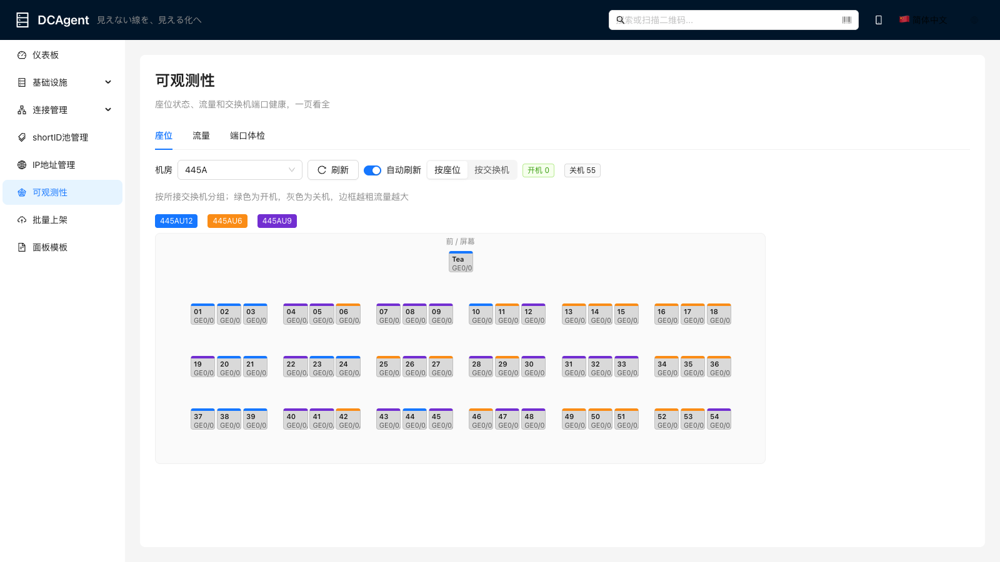
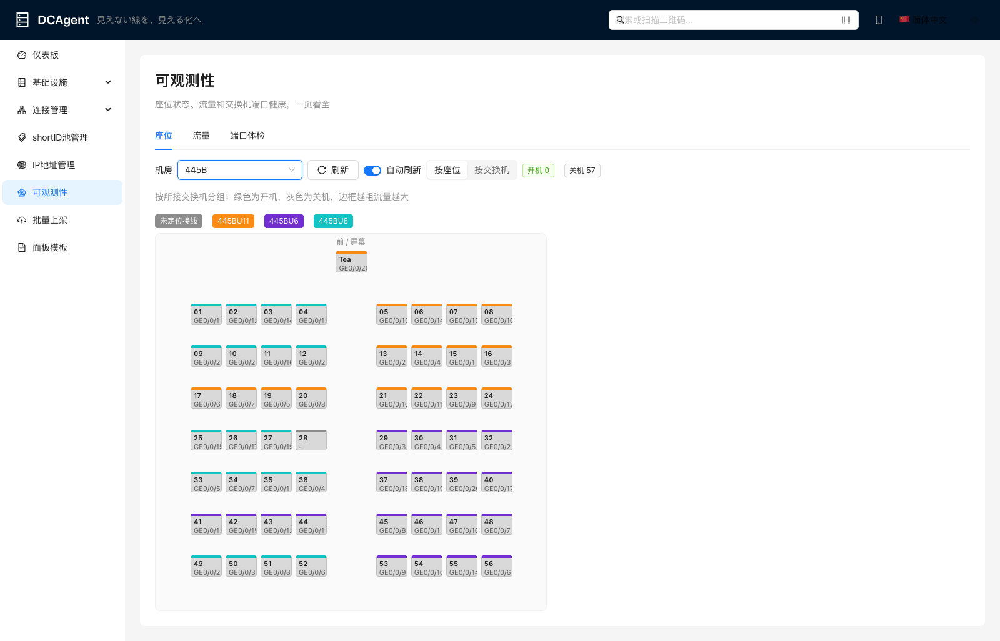
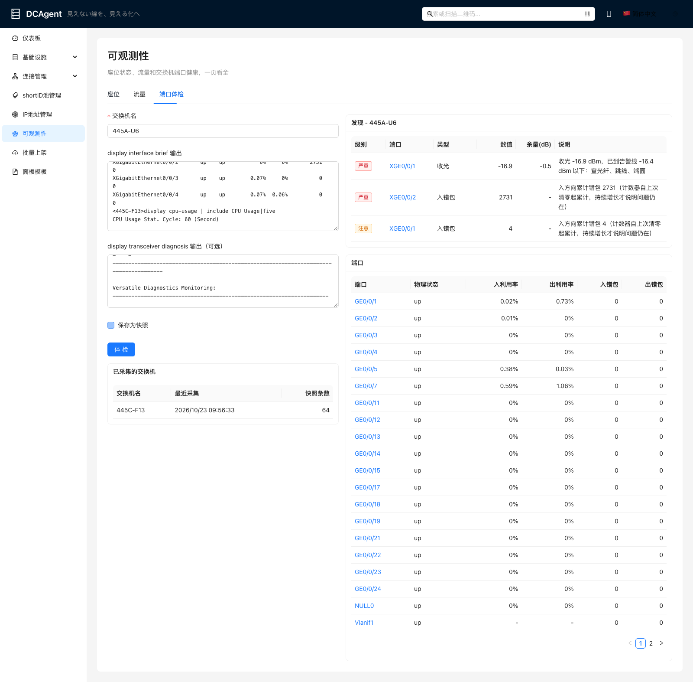
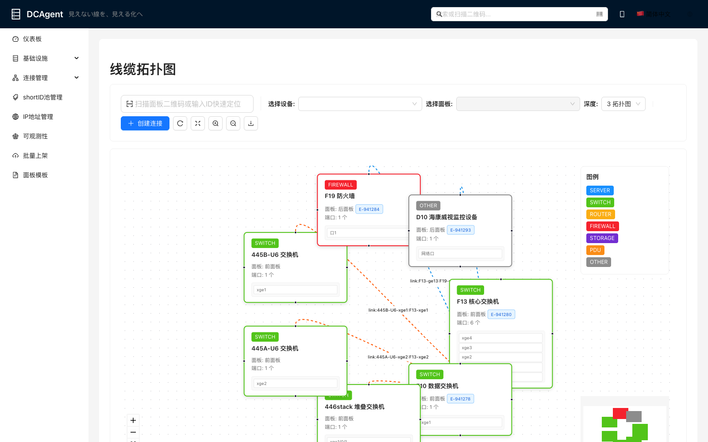

# 可观测性模块

把 2026-10-23 在 445 机房手工做的几件事（座位图、sFlow/NetStream 流量、光纤排障）收进 DCAgent。

前端入口：侧栏「可观测性」(`/observability`)，三个标签页：

| 标签 | 看什么 | 数据从哪来 |
|---|---|---|
| 座位 | 按教室真实排布（或按所接交换机分组）；颜色=开关机，顶部色条=所接交换机，边框粗细=流量 | `Workstation` 表 + 内存里的流量窗口 |
| 流量 | 时间窗口内的 Top 流，IP 自动翻成工作站名 / 设备名 | 采集器推来的 goflow2 记录（内存，不落库） |
| 端口体检 | 粘贴 `display interface brief` 和 `display transceiver diagnosis` 输出，给出结论；可存快照看历史 | `PortObservation` 表 |





## 体检规则

和现场排障经验一致（见 CiderLLM `network/变更记录.md` 10/23 的 445A 光纤）：

- 收/发光低于设备给的 LowAlarm，或设备自己标 Abnormal：严重；在 LowWarn 和 LowAlarm 之间：注意。附带「余量 dB」= 当前值 - LowAlarm。
- 错包计数是累计值。单次看：>= 1000 严重，> 0 注意；**和上一次快照比涨了：严重（ERRORS_GROWING）**，这才说明问题还在。计数器变小（清零、重启）不算增长。
- 利用率 >= 80%：注意。

## 采集器

`backend/scripts/collect-observability.ts`，密码只从环境变量读：

```bash
cd backend
# 常驻：经 jumper tail goflow2 的 flows.json，每 2 秒推一批
JUMPER_PASS=... npx tsx scripts/collect-observability.ts flows

# 抓交换机端口快照（只发 display 命令）
JUMPER_PASS=... SWITCH_PASS=... npx tsx scripts/collect-observability.ts switches \
  445A-U6=192.0.2.31 445C-F13=192.0.2.11

# 同步哦易平台的开关机状态到工作站
npx tsx scripts/collect-observability.ts power
```

**NetStream 采样率**：华为 S6730S（F10）的 NetStream v9 记录里 `sampling_rate` 是 0，不补的话 F10 的流量会被低估成 1/1024。
后端用环境变量 `OBS_DEFAULT_SAMPLING_RATES=192.0.2.12=1024` 补，或者 ingest 时带 `defaultSamplingRates`。

## 导入教室工作站

```bash
cd ~/code/lab-power && python3 -m labpower.cli export > /tmp/labpower.csv
cd ~/code/DCAgent/backend
npx tsx scripts/import-classroom-workstations.ts /tmp/labpower.csv ~/code/CiderLLM/network/seatmap/ports.json          # 预览
npx tsx scripts/import-classroom-workstations.ts /tmp/labpower.csv ~/code/CiderLLM/network/seatmap/ports.json --apply --layout  # 写库，带座位坐标
```

`--layout` 按 `CLASSROOM_LAYOUTS`（和 CiderLLM 静态座位图同一套参数）写入座位坐标（米）和机房尺寸，平面图编辑器里也能看到、拖动。目前只有 445A、445B。

按编号 upsert，不删东西。445A/445B 的接线位置来自座位图的 `ports.json`（MAC 表定位）。

## 交换机互联导入线缆拓扑

巡检记录（CiderLLM `network/console-survey/`）里 LLDP 两端互证的交换机互联，导成线缆，「线缆拓扑」页就能看到：

```bash
cd ~/code/CiderLLM/network/topo && python3 topo.py ../console-survey --json > /tmp/links.json
cd ~/code/DCAgent/backend
npx tsx scripts/import-switch-links.ts /tmp/links.json           # 预览：新增 / 已在库 / 冲突
npx tsx scripts/import-switch-links.ts /tmp/links.json --apply   # 写 PostgreSQL + Neo4j
```

- 库里没有的教室交换机（445A-U6/U9/U12、445B-U6/U8/U11、446stack）按 `NEW_SWITCHES` 建在各教室的「机柜」里。
- 已有的线不动：同一条跳过；端口上接的是别的东西算冲突，只报不改，需要人去现场核对。可重复执行。
- 终端不导成线缆。教室交换机接工作站的口，把座位号写进端口标签（来自工作站的接线位置）。
- 光口一律记成单模光纤，备注里写了「光纤类型未现场核对」。

2026-10-24 导入 8 条（库里原有 A38-F10 一条），教室交换机 7 台，端口标签 111 个。导入前备份 `db-backups/dcagent-before-switch-links-20261024.dump`。



## 接口（参数都走 body，POST）

| 路径 | body | 说明 |
|---|---|---|
| `/api/v1/observability/flows/ingest` | `{ lines: string[], defaultSamplingRates? }` | goflow2 JSON 行，单批 <= 50000 行 / 20MB |
| `/api/v1/observability/flows/top` | `{ windowSeconds=300, limit=20, sampler?, now? }` | `now` 用于回放历史数据 |
| `/api/v1/observability/flows/status` | `{}` | 缓冲条数、见过的采样器 |
| `/api/v1/observability/switches/snapshot` | `{ switchName, deviceId?, interfaceBrief?, transceiver?, save=true }` | 解析 + 体检 + 存快照 |
| `/api/v1/observability/switches/list` | `{}` | 采集过的交换机 |
| `/api/v1/observability/switches/history` | `{ switchName, interface, limit=100 }` | 某个口的快照历史 |
| `/api/v1/observability/workstations/sync-power` | `{ rows: [{name, ip, mac, online}], dryRun }` | MAINTENANCE / FAULTY 不会被覆盖 |
| `/api/v1/observability/workstations/sync-ports` | `{ ports: {座位: [交换机, 端口]}, dryRun }` | 座位图 ports.json 原样传 |
| `/api/v1/observability/workstations/seat-map` | `{ roomId, windowSeconds=10, now? }` | 数字影子 |

## 数据库变更

迁移 `*_observability`：`Workstation` 加 `switchName` / `switchPort` / `lastSeenAt`；新表 `PortObservation`。
执行前的库备份：`db-backups/dcagent-before-observability-20261024.dump`（`pg_restore` 可回滚）。

## 注意

- 流量窗口在后端内存里，后端重启就清空；要长期留存再说（可以落到时序库）。
- **现有 E2E 用例的 `preparePage` 会跑 `data:seed:reset` 清空整个数据库**。已加保护：必须设 `E2E_ALLOW_RESET=1` 才会清库，否则这些用例直接报错退出。
  `e2e/observability.spec.ts` 不重置也不写库，可以单独跑：`npx playwright test e2e/observability.spec.ts`。
